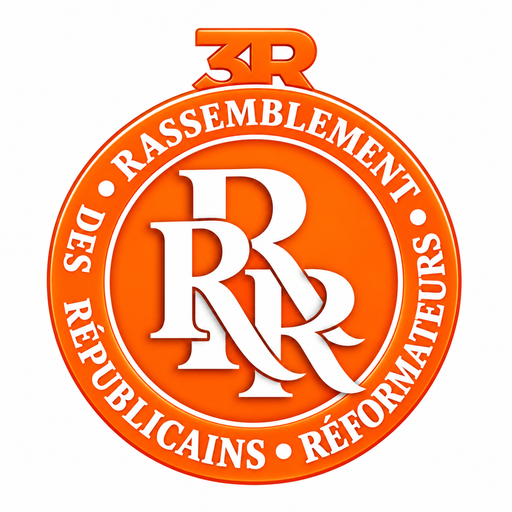

# 3R — Rassemblement des Républicains Réformateurs

Dépôt du parti politique **3R** (Rassemblement des Républicains Réformateurs).

## Identité visuelle

La charte graphique complète (logo, couleurs, typographie, ton, applications) est dans [`charte-graphique.html`](charte-graphique.html).

| Fichier | Usage |
|---|---|
| `assets/logo/logo_3R_orange_blanc.svg` | Logo source (1254×1254) |
| `assets/logo/logo_3R_orange_blanc.pdf` | Logo pour l'impression |
| `assets/logo/logo_3R_orange_blanc.png` | Logo haute résolution (1254×1254) |
| `assets/logo/logo_3R_512.png`, `logo_3R_192.png` | Logos web / icônes d'application |
| `assets/logo/favicon.ico` | Favicon de site (16–64 px) |

### Couleurs

| Rôle | Couleur |
|---|---|
| Orange 3R (principal) | `#FE6501` |
| Blanc | `#FFFFFF` |

### Logo vectoriel (recommandé)

Version redessinée en tracés vectoriels nets (aplats orange `#FE6501` et blanc, sans les effets 3D).
La double bordure (fin filet blanc) est conservée sur le demi-cercle supérieur, comme sur l'original, mais rendue régulière : elle passe sous le « 3R » et s'affine en pointe à ses extrémités.
Elle s'agrandit sans perte et convient à l'impression grand format (affiches, banderoles, t-shirts).

| Fichier | Usage |
|---|---|
| `assets/logo/vectoriel/logo_3R_couleur.svg` / `.pdf` | Logo officiel orange et blanc |
| `assets/logo/vectoriel/logo_3R_orange.svg` / `.pdf` | Une couleur, lettres transparentes (sur fond clair) |
| `assets/logo/vectoriel/logo_3R_blanc.svg` / `.pdf` | Une couleur blanche (sur fond foncé ou orange) |
| `assets/logo/vectoriel/*_2048.png` | Exports PNG 2048 px, fond transparent |

Les fichiers du dossier `assets/logo/` (hors `vectoriel/`) sont les originaux fournis : le SVG d'origine
contient une image matricielle intégrée, pas des tracés vectoriels.

La vectorisation est reproductible avec `scripts/vectoriser_logo.py` (Python + potrace).
